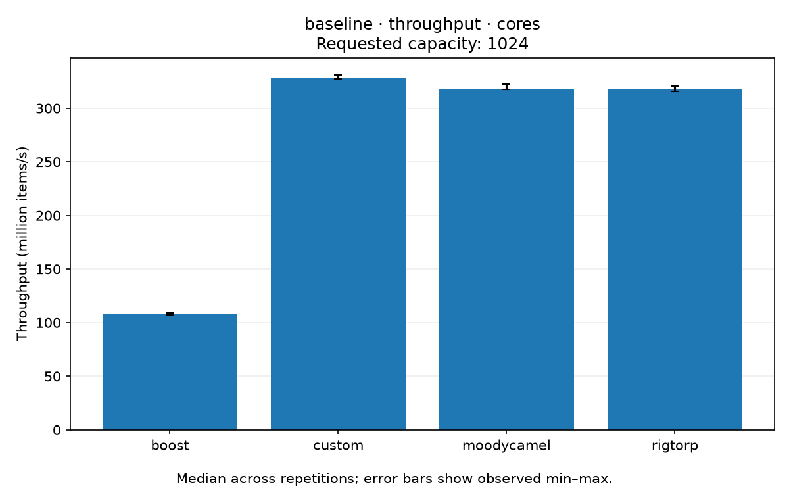
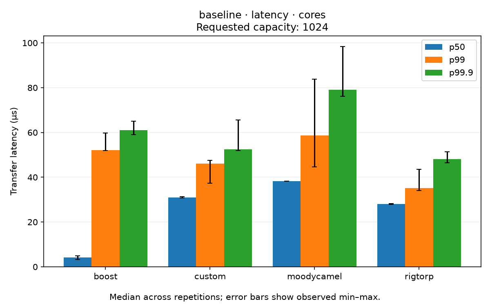
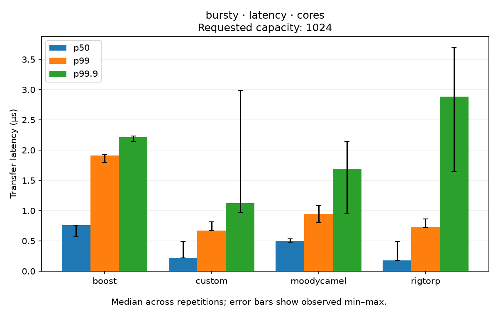

# Results — 21 October 2026

Ryzen 7 3700X · Linux · Release (`-O3`, C++20) · five repetitions per case.
Charts below use separate physical cores (CPUs 0/1) and requested capacity 1,024.

## Continuous throughput

## Continuous latency

## Bursty latency

Bars show medians across five repetitions; error bars show observed min/max.
Throughput and latency come from separate measurement modes. Latency includes
waiting to enqueue and time in the queue; percentiles are summarized across runs.

## Changes since 8 October

The custom queue now caches the opposite thread's index to reduce repeated atomic
loads and uses bitmask indexing into power-of-two storage.

Custom continuous throughput on separate cores, in **million transfers/second**:

| Requested capacity | 8 October | 21 October |
|---|---:|---:|
| 64 | 75.7 | 82.1 |
| 1,024 | 99.0 | 327.8 |
| 16,384 | 108.2 | 305.7 |

The queue implementation and harness retry policy both changed between snapshots;
these compare complete runs rather than isolate individual optimisations.

[Previous throughput summary](../2026-10-08-ryzen-3700x/throughput_summary.csv)

## Full measurements

[Throughput summary](throughput_summary.csv) · [Latency summary](latency_summary.csv) ·
[All charts](plots/) · [Raw CSVs](raw/) · [Run metadata](metadata.json)
